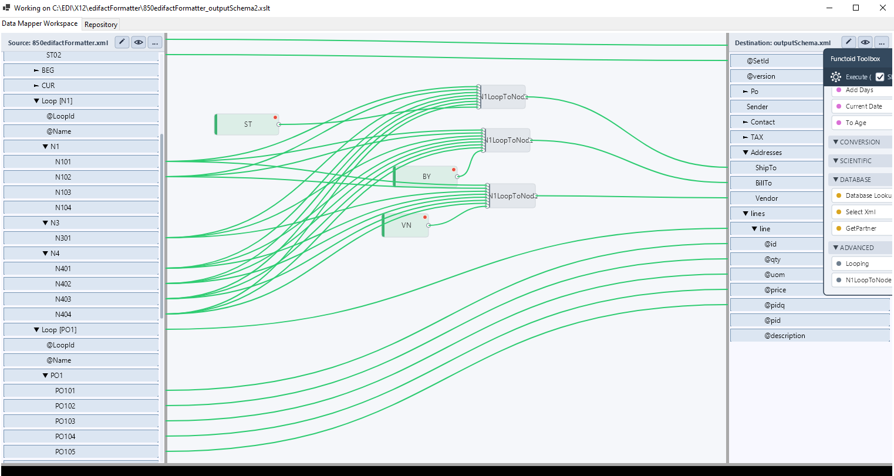
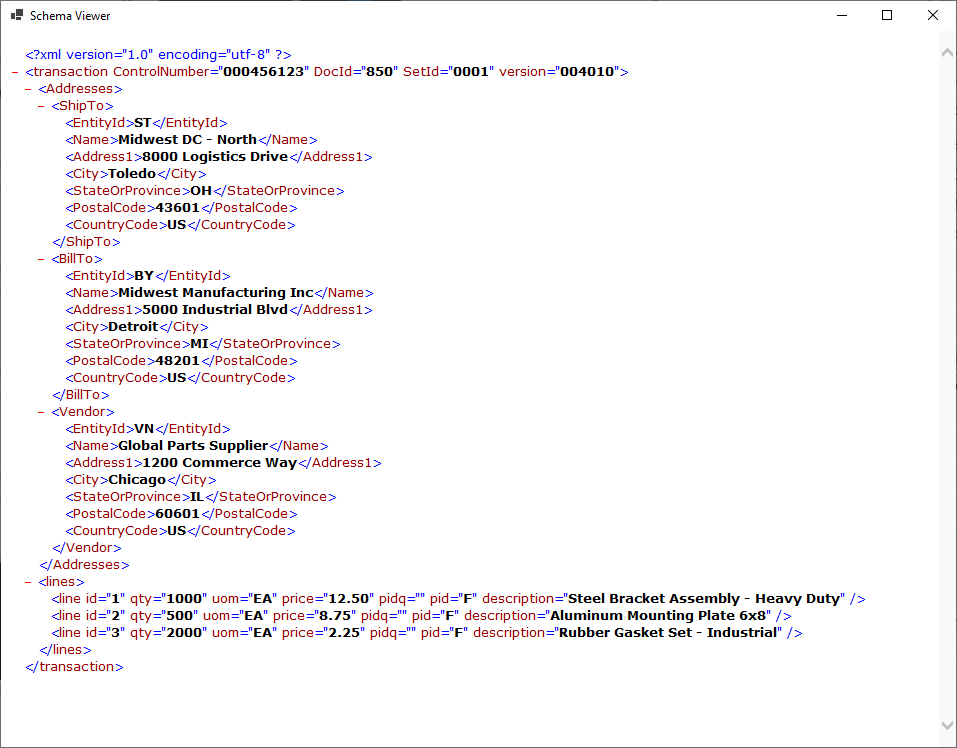
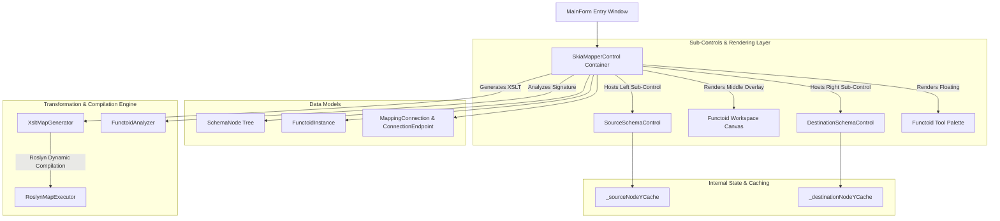
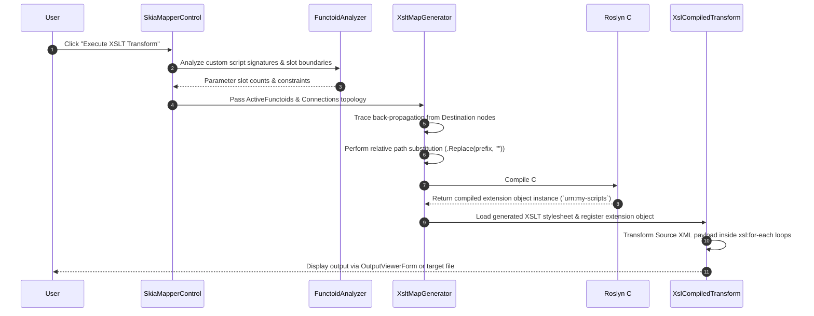
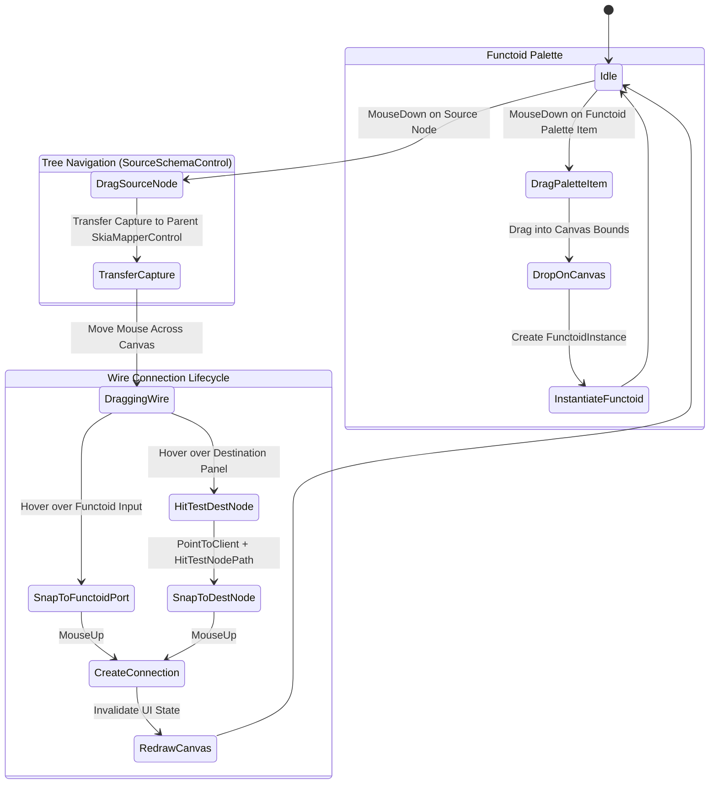

# SkiaMapper

**SkiaMapper** is a high-performance visual schema mapping and transformation layout system built for .NET Windows Forms using **SkiaSharp** vector graphics and **Roslyn** C# compilation scripts. It enables visual mapping between hierarchical source documents (XML, XSD, EDI/X12) and target destination schemas via dynamic functoids and compile-on-the-fly XSLT execution.



## Key Features

* **High-Performance Canvas Rendering**: Fully hardware-accelerated dual-tree and node-wire grid interface using `SkiaSharp`.
* **Decoupled Architecture**: Segregated independent schema tree controls (`SourceSchemaControl` and `DestinationSchemaControl`) for isolated event handling and visual rendering.
* **Dynamic C# Functoids**: Add, configure, duplicate, and execute custom C# script blocks directly inside visual functoid nodes.
* **Context-Aware XSLT & Roslyn Generation**: Translates topological grid layouts into clean XSLT 1.0 stylesheets with relative loop-path substitution and compiles inline C# extension objects dynamically via Roslyn.
* **Cross-Control Mouse Interaction**: Seamless parent-level mouse capture routing supporting direct leaf-to-leaf and functoid-interleaved wire drag-and-drop.
* **Multi-Format Schema Ingestion**: Native parsing for XSD, XML instances, and EDI/X12 formats (via `OopFactory.X12`).
* **Interactive Wire Routing**: Bezier curve wire connections with dynamic multi-port expansion, hit-testing, and real-time execution feedback.
* **Embedded Viewer & Code Editor**: Edit custom Roslyn scripts or schema topologies on the fly with real-time XSLT preview output.

---

## Workspace Operations Overview

The visual mapper workspace is divided into three core operational zones: the **Source Tree (Left)**, the **Workspace Canvas & Functoid Toolbox (Center)**, and the **Destination Tree (Right)**.

```
+------------------------+------------------------------------+------------------------+
|   SOURCE SCHEMA TREE   |     WORKSPACE CANVAS & TOOLBOX     | DESTINATION SCHEMA TREE|
|                        |                                    |                        |
|  - Load EDI/XML/XSD    |  - Dynamic Bezier Wires            |  - Target Output Nodes |
|  - Hierarchical View   |  - Custom C# Script Blocks         |  - Map Target Anchor   |
|  - Expand / Collapse   |  - Floating Palette & Toolbar      |  - Attribute Mapping   |
|  - Virtual Scrolling   |  - Output Execution Engine         |  - Virtual Scrolling   |
+------------------------+------------------------------------+------------------------+
```

### 1. Source Document Panel (Left - `SourceSchemaControl`)
* **Ingestion & Parsing**: Automatically ingests XSD, XML, or flat EDI/X12 files (which are dynamically converted into XML schema structures via `OopFactory.X12`).
* **Tree View Navigation**: Renders collapsible, hierarchical XML elements, attributes (prefixed with `@`), and EDI loops (e.g., `Loop [N1]`, `Loop [PO1]`).
* **Parent Drag Routing**: Initiates wire drag by transferring mouse capture to `SkiaMapperControl`, allowing seamless cross-panel drag-and-drop.
* **Header Actions**:
  * `...` **Ellipsis Button**: Browse and load a new source document.
  * 👁️ **View Button**: Opens the raw source document in the embedded `OutputViewerForm`.
  * ✏️ **Edit Button**: Opens an in-app XML editor to modify the source schema structure directly.

### 2. Workspace Canvas & Functoid Toolbox (Center & Floating - `SkiaMapperControl`)
* **Interactive Wiring**: Drag connections directly from source nodes into functoid input ports, or link functoid outputs directly to destination nodes using smooth Bezier curve vector links.
* **Functoid Instances**:
  * **Dynamic Scaling**: Scale functoid blocks using the mouse wheel over canvas nodes.
  * **Port Auto-Expansion**: Variadic methods (`params` arrays) dynamically expand input ports as additional connection wires are attached.
  * **Customization Tracker**: Shows a red modification dot on functoids whose C# script signature or body has been edited.
* **Floating Tool Palette**:
  * Contains categorized functoids (Conversion, Scientific, Database, Advanced, Scripting).
  * **Canvas Actions**: Save mapping configuration (`.xslt`), Load existing map, Clear Canvas, or Execute XSLT transformation.
  * **Show Output Checkbox**: Toggles whether the transformation result opens immediately upon compilation.

### 3. Destination Document Panel (Right - `DestinationSchemaControl`)
* **Schema Target Anchors**: Renders the target XML node tree structure to receive mapping expressions.
* **Exact Coordinate Translation**: Translates parent mouse events into local control client space via `PointToClient`, resolving target nodes correctly regardless of splitter layout offsets.
* **Loop & Attribute Binding**: Supports standard element binding, attribute assignment, and context-aware loop structure target bindings.
* **Header Actions**: View target schema structure, edit schema XML directly, or load alternative destination definitions with instant user feedback validation.

---

## Output Transformation Preview

Executing a transformation automatically compiles the visual topological mapping into an XSLT payload paired with Roslyn C# extension objects, producing cleanly structured output:



---

## Architecture Overview

### Component Hierarchy

The application follows a modular architecture decoupling the UI rendering controls, data model caching, and compilation pipeline:



## Mapping Pipeline & Execution Flow

When a user executes a transformation map, the system processes node relationships, analyzes functoid parameter constraints, and generates relative XSLT 1.0 templates paired with compiled Roslyn dynamic extensions:



## Functoid & Wire Routing Logic



## File & Class Structure

| Class / Component | Responsibilities | 
| ----- | ----- | 
| **`SkiaMapperControl.cs`** | Core container managing middle-canvas rendering, functoid palette overlay, Bezier connection wires, layout splitters, coordinate translation, and parent-level mouse capture handling. |
| **`SourceSchemaControl.cs`** | Independent subclass of `SKControl` dedicated to source schema tree rendering, virtual scrolling, node Y-cache tracking, and drag initiation. |
| **`DestinationSchemaControl.cs`** | Independent subclass of `SKControl` dedicated to destination tree rendering, node Y-cache tracking, header toolbar controls, and local `HitTestNodePath` hit-testing. |
| **`MainForm.cs`** | Host WinForms container responsible for loading XSD/XML/EDI schema payloads, initializing built-in functoids catalog, and managing project paths. | 
| **`XsltMapGenerator.cs`** | Compiles canvas topology into valid XSLT stylesheets (`xsl:for-each`, `xsl:value-of`, XSLT attributes) with relative loop-path substitution, and generates Roslyn-compiled dynamic C# extension objects (`urn:my-scripts`). | 
| **`FunctoidAnalyzer.cs`** | Uses Roslyn syntax trees to analyze script templates, determining parameter counts, variadic signatures (`params`), and input slot constraints. | 
| **`RoslynMapExecutor.cs`** | Topological sorting engine and Roslyn C# script evaluator for directly executing in-memory transformations outside of traditional XSLT engines. | 

## Getting Started

### Prerequisites

* **.NET 6.0 SDK** or later
* Windows OS (due to Windows Forms dependencies)

## License

This project is open-source and available under the [MIT License](LICENSE).